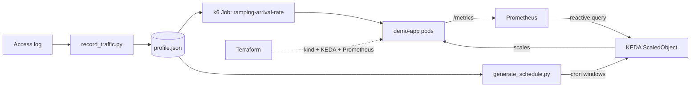

# Predictive Autoscaling with Traffic Replay

Record real traffic, replay it against a test cluster, and compare **static**, **reactive** and **scheduled (predictive)** scaling on cost and latency before production sees the spike.

**DevOps tools:** k6, KEDA, Prometheus, Terraform, Kubernetes (plus Docker and Helm under the hood).

A ready-made presentation is in [docs/predictive-autoscaling.pptx](docs/predictive-autoscaling.pptx).

## How it works



1. **Record**: `record_traffic.py` turns an access log into `traffic/profile.json` (requests per second per bucket).
2. **Replay**: k6 replays the profile at compressed time. 1 bucket = 1 recorded hour = 60 s of replay, so a day takes 24 minutes.
3. **Scale**: three strategies handle the identical load:
   - `static`: fixed pods sized for the peak.
   - `reactive`: KEDA Prometheus trigger, target 15 rps per pod.
   - `scheduled`: KEDA cron windows generated from the profile, with one bucket of look-ahead so pods exist before a load step.
4. **Compare**: pod-minutes (cost proxy), time over the p95 SLO (500 ms), worst p95, charts, and a deck.

The demo app burns 20 ms of CPU per `/work` request and runs with a 500m CPU limit, so one pod handles about 25 rps. That makes capacity predictable.

## Results from the simulator

`python scripts/simulate.py` models the same knobs (15 s poll, 10 s metric lag, 15 s pod start-up, 60 s scale-down window):

| Strategy | Pod-minutes | Cost (USD) | Avg pods | Peak pods | Time over SLO | Worst p95 (s) |
|---|---|---|---|---|---|---|
| static | 144.0 | 0.096 | 6.0 | 6 | 0.0% | 0.3 |
| reactive | 75.25 | 0.0502 | 3.14 | 6 | 5.2% | 1.2 |
| scheduled | 76.0 | 0.0507 | 3.17 | 6 | 0.0% | 0.478 |

These are model outputs, not measurements. Run the cluster lab to get measured numbers; the price is illustrative.

## Quick start A: simulator only (no cluster)

Needs Python 3.10+.

```powershell
pip install -r requirements.txt
python scripts/generate_sample_log.py          # synthetic 24h access log
python scripts/record_traffic.py               # -> traffic/profile.json
python scripts/simulate.py                     # prints comparison table
python scripts/report.py --source simulation   # charts in results/simulation
python scripts/build_deck.py --source simulation
```

Use your own log: `python scripts/record_traffic.py --log my_access.log --buckets 24 --peak-rps 90` (common/combined log format).

## Quick start B: full lab on a local cluster

Prerequisites: Docker Desktop (about 6 CPUs and 8 GB RAM), [kind](https://kind.sigs.k8s.io/), [Terraform](https://developer.hashicorp.com/terraform) >= 1.5, kubectl, Python.

```powershell
cd terraform
terraform init
terraform apply          # kind cluster, KEDA, kube-prometheus-stack, loads app and k6 images
cd ..
kind export kubeconfig --name autoscale-lab

python scripts/run_experiment.py                      # about 25 minutes per strategy
python scripts/report.py --source cluster
python scripts/build_deck.py --source cluster
```

Run one strategy only: `python scripts/run_experiment.py --modes reactive`.

Clean up: `cd terraform; terraform destroy`.

Watch live (optional): `kubectl -n monitoring port-forward svc/kube-prometheus-stack-grafana 3000:80` (login `admin` / `admin`, set in `terraform/variables.tf`, local lab only).

## Quick start C: run on AWS (EKS)

`terraform-aws/` builds a VPC, an EKS cluster with 3 `t3.large` nodes, an ECR repository (the app image is built and pushed for you), KEDA and kube-prometheus-stack. The experiment scripts are unchanged: they only need `kubectl` pointed at the cluster.

Prerequisites: an AWS account, AWS CLI v2 configured (`aws sts get-caller-identity` works), Docker running, Terraform >= 1.5, kubectl, Python. The IAM user or role needs permissions for VPC, EKS, EC2, IAM and ECR.

```powershell
cd terraform-aws
terraform init
terraform apply -var region=us-east-1     # about 15-20 minutes
aws eks update-kubeconfig --name autoscale-lab --region us-east-1
cd ..

$image = terraform -chdir=terraform-aws output -raw image
python scripts/run_experiment.py --image $image
python scripts/report.py --source cluster
python scripts/build_deck.py --source cluster

terraform -chdir=terraform-aws destroy -var region=us-east-1   # always, to stop billing
```

Notes:

- **Cost:** roughly $0.10/h for the EKS control plane plus about $0.25/h for three `t3.large` nodes, so a few dollars for a full run. No NAT gateway or load balancer is created. Destroy the stack when you finish.
- **Security:** the cluster API endpoint is public and restricted by IAM. Grafana is off by default; to enable it set `-var enable_grafana=true -var grafana_admin_password=<strong password>` and reach it only through `kubectl port-forward`.
- **Capacity:** the app, Prometheus and KEDA need about 4 vCPU in total. Do not lower `node_count` below 3 with `t3.large`.
- **Other clouds:** the same flow works on GKE or AKS. Replace `terraform-aws/` with the cloud's cluster module, keep the Helm releases, and pass your registry image to `--image`.

## Project layout

| Path | Purpose |
|---|---|
| `app/` | Flask demo service with Prometheus metrics and Dockerfile |
| `k6/replay.js` | Replays `profile.json` with the arrival-rate executor |
| `k8s/` | Namespace, Deployment, Service, ServiceMonitor, reactive ScaledObject, k6 Job template |
| `terraform/` | kind cluster, KEDA and Prometheus via Helm, image loading |
| `terraform-aws/` | EKS cluster, ECR repository, KEDA and Prometheus via Helm |
| `traffic/profile.json` | Recorded traffic profile (sample included) |
| `scripts/record_traffic.py` | Access log to profile |
| `scripts/generate_schedule.py` | Profile to KEDA cron ScaledObject, aligned to the run start time |
| `scripts/simulate.py` | Cluster-free model of all three strategies |
| `scripts/run_experiment.py` | Orchestrates the live runs and collects metrics from Prometheus |
| `scripts/report.py` | Charts and summary table |
| `scripts/build_deck.py` | Generates the PowerPoint |

## Tuning knobs

All in [scripts/common.py](scripts/common.py); keep them in sync with `k8s/*.yaml` and `app/main.py`.

- `THRESHOLD_RPS_PER_POD`: scaling target, also in `k8s/scaledobject-reactive.yaml`.
- `MIN_REPLICAS` / `MAX_REPLICAS`: also in both ScaledObjects.
- `SLO_P95_SECONDS`, `PRICE_PER_POD_HOUR`: used for the report.
- `generate_schedule.py --lookahead N`: buckets of pre-warming (0 disables it).
- `WORK_MS` env var in `k8s/app.yaml`: CPU per request (changes pod capacity, update `CAPACITY_RPS_PER_POD`).

## Caveats

- Cron triggers have one-minute granularity, so a replay bucket is at least 60 s.
- Scheduled scaling only pays off when traffic repeats; add a reactive fallback for surprises in production.
- The kind nodes share your machine's CPU, so a loaded laptop skews latency. Close heavy apps during runs.
- The Helm chart versions are pinned in `terraform/variables.tf`; bump them if they are no longer available.
- Terraform, kind and k6 were not run when this project was generated. The simulator, scripts, k6 syntax and deck were executed; verify the cluster path on your machine and adjust chart versions or values if a release has changed.

## Troubleshooting

- `CRD ... not found`: `terraform apply` has not finished, or `kubectl` points at another cluster (`kubectl config current-context` should be `kind-autoscale-lab`).
- Empty p95 or rps in results: check the target in Prometheus (`kubectl -n monitoring port-forward svc/kube-prometheus-stack-prometheus 9090`, then Status > Targets).
- Scheduled run never scales: confirm the cron windows match UTC time (`kubectl -n autoscale-lab get scaledobject demo-scheduled -o yaml`).
- k6 pod `ImagePullBackOff`: re-run `terraform apply -replace=null_resource.k6_image`.
